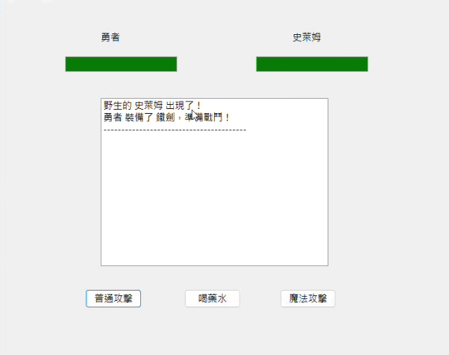

# C++ Object-Oriented RPG Battle Simulator

## 專案概述 
本專案為使用 C++Builder 開發之 2D 視窗化 RPG 戰鬥模擬器。專案核心目標為跳脫傳統控制台限制，於圖形化介面中實踐物件導向程式設計觀念，並透過 VCL 元件處理事件驅動與遊戲迴圈。

## 系統架構設計
為落實高內聚、低耦合的設計原則，將遊戲實體拆分為四個核心類別模型：

一、Character 
將遊戲生物共有的核心屬性進行封裝，並統一處理扣血判定，避免血量低於零導致的 UI 顯示異常。

二、Player 
繼承自 Character，額外擴充魔力值屬性以限制特定攻擊次數。同時在內部宣告 Weapon 類別變數，透過物件組合賦予角色裝備武器的能力。

三、Monster 
繼承自 Character，作為由系統自動運算與控制的敵方模型。

四、Weapon 
專責存放武器屬性與附加傷害值，確保裝備數值邏輯獨立於角色本體之外。

## 實務踩坑與技術亮點
開發初期遭遇 UI 更新節奏與預期不符的狀況。由於底層運算極快，玩家點擊攻擊與敵方反擊幾乎瞬間完成，對話框同時印出多行戰鬥紀錄，完全喪失回合制體驗。

為解決此節奏控制問題，主動導入 TTimer 元件搭配狀態控制機制。玩家發動攻擊後，系統會立即鎖定操作面板並啟動計時器，強制延遲運算一秒後，再觸發敵方反擊邏輯與 UI 血條更新，藉此精準掌控遊戲節奏並防止按鍵連點異常。

## 擴充性與架構設計反思 
本專案在基礎類別中宣告了虛擬函式 。在目前的實作中，為了方便於 UI 介面上直接存取子類別專屬屬性，我選擇宣告明確的子類別指標。

儘管如此，系統仍堅持保留 `virtual` 虛擬函式的底層設計。雖然目前版本為一對一戰鬥，但此設計已為未來的系統擴充預留了符合 OCP 的極大彈性與動態綁定空間。
