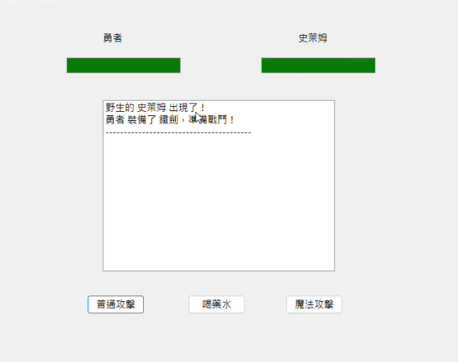

# C++ Object-Oriented RPG Battle Simulator

## 專案概述 
本專案為使用 C++Builder 開發之 2D 視窗化 RPG 戰鬥模擬器。專案核心目標為跳脫傳統控制台限制，於圖形化介面中實踐物件導向程式設計觀念，並透過 VCL 元件處理事件驅動與遊戲迴圈。

## 系統架構設計
為落實高內聚、低耦合的設計原則，將遊戲實體拆分為四個核心類別模型：

一、Character 
將遊戲生物共有的核心屬性進行封裝，並統一處理扣血判定，避免血量低於零導致的 UI 顯示異常。

二、Player 
繼承自 Character，額外擴充魔力值屬性以限制特定攻擊次數。同時在內部宣告 Weapon 類別變數，透過物件組合賦予角色裝備武器的能力。

三、Monster 
繼承自 Character，作為由系統自動運算與控制的敵方模型。

四、Weapon 
專責存放武器屬性與附加傷害值，確保裝備數值邏輯獨立於角色本體之外。

## 實務踩坑與技術亮點
開發初期遭遇 UI 更新節奏與預期不符的狀況。由於底層運算極快，玩家點擊攻擊與敵方反擊幾乎瞬間完成，對話框同時印出多行戰鬥紀錄，完全喪失回合制體驗。

為解決此節奏控制問題，主動導入 TTimer 元件搭配狀態控制機制。玩家發動攻擊後，系統會立即鎖定操作面板並啟動計時器，強制延遲運算一秒後，再觸發敵方反擊邏輯與 UI 血條更新，藉此精準掌控遊戲節奏並防止按鍵連點異常。

## 架構檢討與反思 
專案原意利用 virtual 虛擬函式展現多型特性，期望不同角色呼叫同名 attack() 函式時，能產生截然不同的傷害邏輯。

於開發後期進行架構覆盤時，察覺目前的實作方式存在設計盲點。現有程式碼直接宣告了明確的子類別指標，編譯器本就會自動綁定對應函式。多型發動的真正技術前提，應是以父類別指標指向子類別實體，此時宣告 virtual 才有其實質的動態綁定意義。這是本次開發在理論與實務對接上獲得的重要啟發，後續專案將嚴格遵循此設計模式進行重構與開發。
